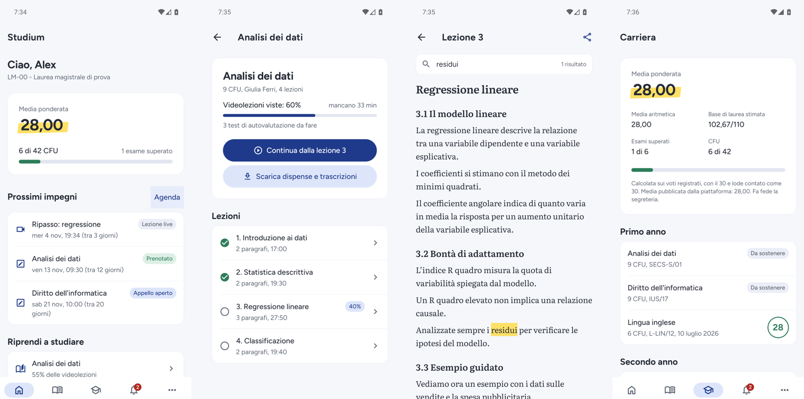

<h1 align="center">Studium</h1>

<p align="center"><strong>Il compagno di studio open-source per l'università digitale.</strong><br>
App Android in sola lettura per le università online che usano la stessa piattaforma studenti.</p>

<p align="center">
  <a href="https://github.com/minchiox/studium/actions/workflows/ci.yml"></a>
  <a href="https://github.com/minchiox/studium/releases/latest"></a>
  <a href="LICENSE"></a>
  
</p>

> [!IMPORTANT]
> **Progetto indipendente e non ufficiale.** Studium non è affiliato, approvato né sostenuto da alcun ateneo o gruppo universitario. I nomi e i marchi delle università appartengono ai rispettivi titolari e sono citati solo per indicare la compatibilità. Usa il tuo account personale e rispetta il regolamento della tua università.

<p align="center"></p>

## Indice

- [Cosa fa](#cosa-fa)
- [Cosa non fa, per scelta](#cosa-non-fa-per-scelta)
- [Installa l'app](#installa-lapp)
- [Sviluppo](#sviluppo)
- [Architettura](#architettura)
- [Sicurezza e privacy](#sicurezza-e-privacy)
- [Qualità](#qualità)
- [Roadmap](#roadmap)
- [Licenza](#licenza)

## Cosa fa

Studium è un client per la piattaforma studenti (Chamilo LMS con web app e API REST) condivisa da più università online. Legge i tuoi dati e li organizza per lo studio:

- **Home "Da fare"**: le prossime azioni in ordine di urgenza (esiti da confermare, esame di oggi, prenotazioni in chiusura, ripasso, lezione da riprendere), media ponderata, CFU e prossimi impegni.
- **Esami e appelli**: prenotazioni, appelli prenotabili con la scadenza della prenotazione, esiti da confermare, promemoria. Si prenota sulla **pagina ufficiale dell'ateneo**, aperta nell'app.
- **Corsi e lezioni**: avanzamento delle videolezioni, tempo che manca, test di autovalutazione da fare.
- **Trascrizioni** ricavate dai sottotitoli, con ricerca ed evidenziatore.
- **Dispense offline** e **ricerca offline** in tutte le trascrizioni scaricate.
- **Carriera**: libretto per anno, voti, media aritmetica e ponderata, base di laurea stimata.
- **Agenda**: esami prenotati, appelli aperti, lezioni live, con promemoria locali.
- **Avvisi** dell'ateneo con gli allegati.
- **Quiz ed esercitazioni locali**: domande generate sul telefono dalle trascrizioni (completamento, vero o falso, argomento del passaggio), con spiegazione, link al paragrafo e banca personale con ripasso a intervalli. Gratis e offline.
- **Tema chiaro e scuro** che segue le impostazioni di sistema.

> [!NOTE]
> **Funzioni IA temporaneamente disattivate.** Il provider IA facoltativo (quiz generati da un modello compatibile OpenAI) e il server MCP per gli assistenti IA sono spenti dal flag `ENABLE_AI_FEATURES = false` in [`packages/core/src/features.ts`](packages/core/src/features.ts). Il codice resta nel repository ed è coperto dai test, ma l'app non mostra le impostazioni IA e il server MCP (`studium-mcp serve`) non si avvia; i comandi da terminale senza IA (`login`, `courses`, `sync`…) funzionano. I quiz locali, che non usano IA, restano disponibili.

## Cosa non fa, per scelta

Studium **non scrive nulla sulla piattaforma**: non registra la frequenza, non segna le lezioni come viste, non compila test, non prenota né cancella esami. Per prenotare apre la pagina ufficiale; la frequenza la registra solo il **player ufficiale**, mentre guardi. La garanzia è nel codice (vedi [Sicurezza e privacy](#sicurezza-e-privacy)), non in una promessa.

## Installa l'app

1. Dal telefono, scarica dall'[ultima release](https://github.com/minchiox/studium/releases/latest) `studium-<versione>-arm64-v8a.apk` (quasi tutti i telefoni) oppure `-armeabi-v7a.apk` per i telefoni a 32 bit, e aprilo. Android chiede di consentire l'installazione da questa fonte.
2. Al primo avvio tocca **Collega la tua università** e inserisci l'indirizzo dell'area studenti, ad esempio `https://lms.<ateneo>.<dominio>/`.
3. Accedi come sempre, **sulla pagina ufficiale**. Studium riconosce da solo la piattaforma: indirizzo dell'API, cookie della sessione, host di video e sottotitoli.

La configurazione si può esportare e importare (Impostazioni → Esporta configurazione). Prima di ogni importazione l'app mostra i domini che la configurazione userà e rifiuta quelli non coerenti o troppo generici (per esempio `it`, `com`, `ac.uk`).

**Compatibilità.** Studium è **verificato end-to-end su un ateneo**. Gli altri atenei della stessa piattaforma rispondono in modo identico alle verifiche anonime; la verifica con un account è un comando ([`docs/api.md`](docs/api.md#compatibilità)). Se la piattaforma non è compatibile, l'app lo dice invece di mostrare dati sbagliati.

## Sviluppo

Requisiti: Node.js ≥ 22.18 e, per l'app, un dispositivo o emulatore Android.

```bash
npm ci
npm run build          # core e server MCP
npm test               # unit, contract ed end-to-end MCP (nessun account richiesto)

npm run mock           # piattaforma di prova su http://localhost:4010 (utente: demo, password: demo)
npm run mobile         # Metro: apri l'app con Expo Go (premi "a" per l'emulatore)
```

Su un telefono vero con il mock: `adb reverse tcp:4010 tcp:4010`.

```bash
npm run check                              # lint, typecheck e test
npm run e2e -w @studium/mobile             # E2E Android, con emulatore, mock e Metro avviati
```

**Profilo integrato.** Una build personale può includere già il profilo dell'ateneo: copia [`profiles/example.json`](profiles/example.json) in `profiles/default.json` (ignorato da git), poi `npm run apk -w @studium/mobile`. La build pubblica si ottiene con `STUDIUM_PROFILE=none`. Dettagli in [`profiles/README.md`](profiles/README.md) e [`apps/mobile/README.md`](apps/mobile/README.md).

## Architettura

| Modulo | Ruolo |
|---|---|
| [`apps/mobile`](apps/mobile) | App Android: Expo + React Native, interfaccia Material, tema chiaro e scuro, funziona offline |
| [`packages/core`](packages/core) | Client TypeScript portabile (Node e Hermes): validazione delle risposte con zod, guardia read-only, dominio (carriera, esami, agenda, quiz) |
| [`packages/mcp`](packages/mcp) | Server MCP per gli assistenti IA, **temporaneamente disattivato** |
| [`apps/mock-lms`](apps/mock-lms) | Piattaforma finta con dati inventati: il contratto eseguibile per test ed E2E |

```
apps/mobile ──┐                     ┌─► fetch (React Native) + WebView per login e rinnovo
              ├─► packages/core ────┤
packages/mcp ─┘   (client, guardia, └─► Playwright (Node) per il server MCP
                   parsing, dominio)
apps/mock-lms ◄── contract test ed E2E
```

Le decisioni principali sono negli ADR:

- [0001 — Monorepo e core portabile](docs/adr/0001-monorepo-e-core-portabile.md)
- [0002 — Sessione tramite la web app ufficiale](docs/adr/0002-sessione-tramite-web-app.md)
- [0003 — Funzioni IA](docs/adr/0003-funzioni-ia.md)
- [0004 — Prenotazioni sulla pagina ufficiale](docs/adr/0004-prenotazioni-sulla-pagina-ufficiale.md)

Le API della piattaforma, ricostruite e commentate, sono in [`docs/api.md`](docs/api.md).

## Sicurezza e privacy

Studium è **solo client**: nessun server nostro, nessuna telemetria, nessun account Studium. I dettagli sono nella [Privacy Policy](PRIVACY_POLICY.md).

- **Accesso sulla pagina ufficiale.** Il login avviene nella pagina dell'ateneo dentro una WebView: la password non passa mai dal codice di Studium. L'app legge solo il token di accesso che la web app imposta in un cookie leggibile; il refresh token resta un cookie HttpOnly che Studium non legge.
- **Rinnovo della sessione fatto dalla web app**, in una WebView nascosta: nessun segreto OAuth nel codice, nessuna chiamata diretta agli endpoint di autenticazione.
- **Token cifrato** con il Keystore di Android. Cache, dispense e trascrizioni restano nella memoria privata dell'app.
- **Garanzia read-only.** Ogni richiesta del client passa da una guardia ([`packages/core/src/guard.ts`](packages/core/src/guard.ts)): gli endpoint di tracciamento della frequenza sono bloccati con qualsiasi metodo e su qualsiasi host, e le scritture verso l'API studenti sono bloccate tranne un elenco ristretto di percorsi di sessione.
- **WebView confinate.** Login, pagine ufficiali, player e rinnovo possono navigare solo sugli host dell'ateneo; i link esterni vengono bloccati, anche se arrivano da un deep link, e si possono aprire solo nel browser di sistema, che non condivide la sessione.
- **Configurazioni importate verificate**: ogni indirizzo deve appartenere ai domini dichiarati, i suffissi pubblici sono rifiutati e l'utente conferma i domini prima dell'importazione.

Vulnerabilità: segui [SECURITY.md](SECURITY.md). Dispense e lezioni appartengono ai rispettivi autori: sono per lo studio personale e non vanno ridistribuite.

## Qualità

| Livello | Cosa | Dove |
|---|---|---|
| Unit | parsing, guardia, client (rinnovo, retry, errori, richieste condivise), carriera, agenda, appelli e finestre di prenotazione, quiz, ripasso | `packages/core/test` |
| Contract | client reale contro il mock via HTTP, incluso il rinnovo della sessione | `apps/mock-lms/test` |
| MCP end-to-end | client e server MCP contro il mock | `packages/mcp/test` |
| Android E2E | configurazione, login, studio, download, ricerca, carriera, avvisi, agenda, esami, rinnovo, logout, verifica read-only; anche su piattaforma reale con `--site` e `--cred` | `apps/mobile/e2e` |

La CI ([`ci.yml`](.github/workflows/ci.yml)) esegue lint, typecheck e test su Node 22 e 24 e verifica il bundle JavaScript Android.

## Roadmap

- [x] Quiz con motore locale gratuito ([ADR 0003](docs/adr/0003-funzioni-ia.md))
- [x] Banca esercitazioni personale con ripasso a intervalli
- [x] Esami e appelli con prenotazione sulla pagina ufficiale ([ADR 0004](docs/adr/0004-prenotazioni-sulla-pagina-ufficiale.md))
- [x] Hardening: configurazioni importate verificate, WebView confinate agli host dell'ateneo
- [ ] Riattivazione delle funzioni IA (provider compatibile OpenAI e server MCP)
- [ ] Riassunti delle lezioni
- [ ] Widget per la home di Android e notifiche per i nuovi avvisi
- [ ] Build iOS

## Contribuire

Leggi [CONTRIBUTING.md](CONTRIBUTING.md). Il sito del progetto è una pagina statica in [`docs/index.html`](docs/index.html), pubblicabile con GitHub Pages dalla cartella `/docs`.

## Licenza

[MIT](LICENSE). Il progetto non ha legami con le università citate: vedi l'avviso in cima a questa pagina.
